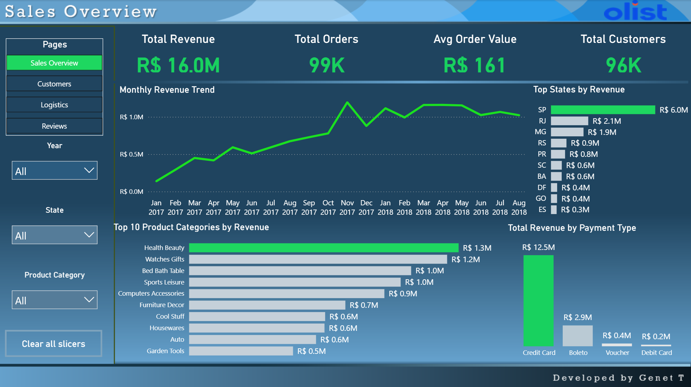
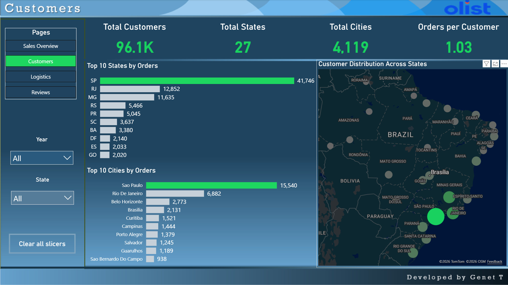
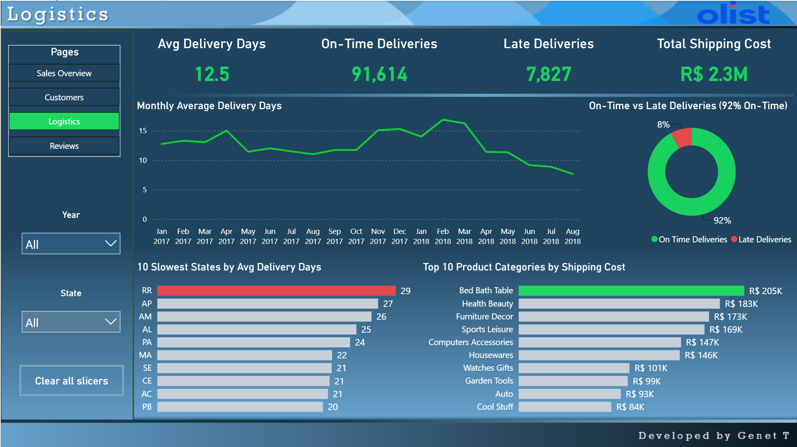
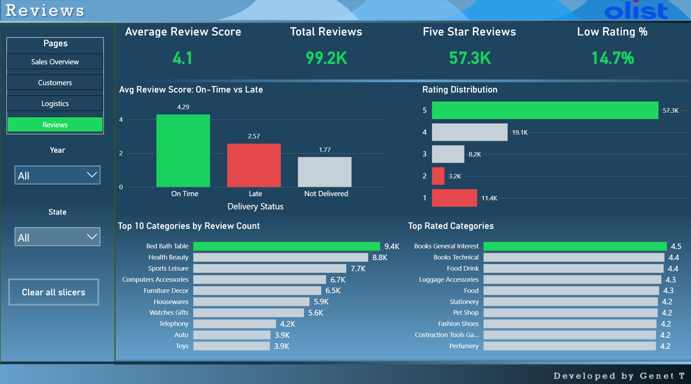

# Olist E-Commerce Analytics Dashboard (Power BI)

An end-to-end Power BI dashboard built on the **Olist Brazilian E-Commerce dataset** (~100K orders, 2016–2018). The data was loaded into **PostgreSQL**, modeled and cleaned in **Power Query**, and analyzed with **DAX** across four report pages: Sales, Customers, Logistics, and Reviews.

**Headline finding:** late deliveries cut the average review score from **4.29 to 2.57**. Logistics performance directly drives customer satisfaction.

---

## Dashboard Pages

### 1. Sales Overview


- **R$ 16.0M** total revenue from **99K orders** and **96K customers** (average order value R$ 161)
- Steady growth through 2017, with a peak in **November 2017** (Black Friday)
- **São Paulo** generates about R$ 6.0M, nearly 3× the next state (RJ, R$ 2.1M)
- **Credit card** accounts for about 78% of payment value
- Top category by revenue: **Health & Beauty**

### 2. Customers


- **96.1K** unique customers across **27 states** and **4,119 cities**
- **1.03 orders per customer**, meaning about 97% of customers never placed a second order. **Retention is the biggest growth opportunity.**
- Customer base is concentrated in the Southeast (SP, RJ, MG), shown on an Azure Map of Brazil

### 3. Logistics


- **12.5 days** average delivery time; **92%** of orders delivered on time
- Remote northern states (**RR, AP, AM**) average 25–29 days, about **3× slower than SP** (9 days)
- Delivery times improved sharply in 2018, from about 17 days (Feb–Mar) to about 8 days (Aug)
- **R$ 2.3M** total shipping cost; Bed Bath Table is the most expensive category to ship

### 4. Reviews


- **4.1** average review score across **99.2K reviews**; **14.7%** are low ratings (1–2 stars)
- **On-time orders: 4.29 · Late orders: 2.57 · Not delivered: 1.77**
- Top-rated categories are ranked only among categories with **100+ reviews**, so small categories can't top the list by chance

---

## Tools & Skills

| Area | Details |
|---|---|
| Database | PostgreSQL 18 (data storage, source for Power BI) |
| Python | pandas, SQLAlchemy, psycopg2, Matplotlib in Google Colab |
| Data prep | Power Query: text cleanup (e.g. `health_beauty` → "Health Beauty"), category translation |
| Modeling | Fact/dimension relationships, dedicated Date table, separate measures table |
| DAX | KPIs, time intelligence, conditional-format color measures, calculated columns |
| Visualization | KPI cards, trend lines, ranked bar charts, donut, Azure Map, synced slicers |

## DAX Highlights

**Delivery status (calculated column)**, used to compare review scores for on-time vs late orders:
```DAX
Delivery Status =
IF (
    ISBLANK ( 'public orders'[order_delivered_customer_date] ), "Not Delivered",
    IF ( 'public orders'[order_delivered_customer_date] > 'public orders'[order_estimated_delivery_date], "Late", "On Time" )
)
```

**Dynamic highlight color**, which colors the top bar green and the rest gray, and updates with slicers:
```DAX
Category Bar Color =
VAR TopVal =
    MAXX ( ALLSELECTED ( 'public category_translation'[product_category_name_english] ), [Product Revenue] )
RETURN
    IF ( [Product Revenue] = TopVal, "#1ED760", "#C5D0D9" )
```

**Minimum-sample rating**, so categories with fewer than 100 reviews are excluded before ranking:
```DAX
Avg Review Score (100+ Reviews) =
IF ( [Total Reviews by Category] >= 100, [Average Review Score by Category] )
```

## Design Choices

- **Consistent color logic:** green highlights the top item, red flags problems (slowest state, late deliveries, low ratings), gray for everything else
- **Brazilian currency (R$)** throughout, since all values are in BRL
- **Honest axes:** the delivery trend starts at 0, so changes aren't exaggerated
- **Revenue definitions:** Total Revenue uses payment value (includes freight); category revenue uses item price (excludes freight)

## SQL Analysis (PostgreSQL)

The raw data is stored in a PostgreSQL 18 database (`Brazilian_Ecom`) with 9 tables: `orders`, `order_items`, `order_payments`, `order_reviews`, `customers`, `sellers`, `products`, `geolocation`, `category_translation`.

[`sql/olist_analysis.sql`](sql/olist_analysis.sql) reproduces the dashboard's key findings directly in SQL:

1. Business overview KPIs (revenue, orders, customers, AOV)
2. Monthly revenue trend
3. Top 10 categories by revenue (joined to English category names)
4. Customer retention: repeat-customer rate using a CTE
5. 10 slowest states by average delivery days and on-time %
6. **Review score by delivery status (On Time vs Late vs Not Delivered)**
7. Top-rated categories with a minimum of 100 reviews (`HAVING`)

[`sql/olist_schema.sql`](sql/olist_schema.sql) contains the table definitions.

## Python Analysis (Google Colab)

[`python/olist_analysis.ipynb`](python/olist_analysis.ipynb) connects to the PostgreSQL database with **SQLAlchemy + psycopg2**, runs SQL into **pandas** DataFrames, and visualizes the results with **Matplotlib**. It answers 10 business questions:

1. Top-selling product categories
2. Highest-revenue states
3. Top-performing sellers
4. Most popular payment methods
5. Delivery time by state
6. Impact of late deliveries on review scores
7. Best- and worst-reviewed categories
8. Average order value
9. Cities with the most customers
10. What drives freight cost (correlation of weight, size, and price with shipping cost)

**Workflow:** PostgreSQL (storage) → Python (SQL + analysis + charts) → Power BI (interactive dashboard)

## Data Source

[Brazilian E-Commerce Public Dataset by Olist](https://www.kaggle.com/datasets/olistbr/brazilian-ecommerce) (Kaggle)

## How to Open

1. Download `Olist_Dashboard.pbix`
2. Open it in [Power BI Desktop](https://www.microsoft.com/power-bi/desktop) (free)
3. The data is already imported, so the report opens without a database connection. Refreshing requires the PostgreSQL source.

---

**Developed by GenetM** · [LinkedIn]([#](https://www.linkedin.com/in/genet-m-56174b294/?isSelfProfile=true)) · [Portfolio](#)
